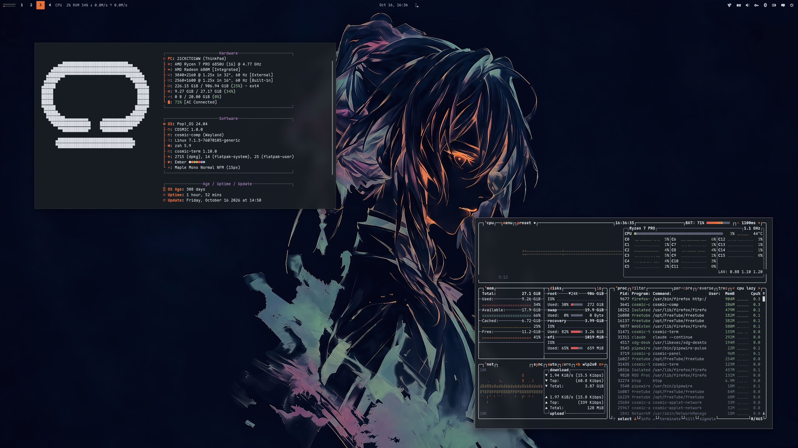

<div align="center">

# COSMIC · Ember

Pop!_OS 24.04 on COSMIC in Ember blue-black, fog and one ember accent: desktop,
terminal, shell, editor, Firefox, cursor, wallpapers. The dark half of a pair;
the light half is [cosmic-emberday-theme](https://github.com/atraxsrc/cosmic-emberday-theme).


</div>

---


## Palette

Ember is one design in two halves: cold blue-black night, warm stone day, one
ember accent shared by both. Big shapes (window, containers, text) are neutral; the
ember is small and loud (accent, window hint, commands) and everything else in the
ANSI set stays calm, pairing by lightness only. Every role you read as text clears
4.5:1 on the window `#15171C`; the terminal is an opaque pane `#1B1E24`, one step lighter
than the desktop.

| Role | Color | Hex |
|------|-------|-----|
| Background |  Night | `#15171C` |
| Containers |  Soot / Pane | `#22262E` / `#1B1E24` |
| Terminal |  Pane, opaque | `#1B1E24` |
| Text |  Fog | `#D6D9E0` |
| Accent |  Ember | `#E8713A` |
| Success |  Moss | `#8FB58A` |
| Warning |  Amber | `#D9A441` |
| Error |  Brick | `#D85A5A` |
| Blue |  Slate blue | `#7FA3C7` |
| Magenta |  Heather | `#B08BC4` |
| Cyan |  Verdigris | `#7FB7B3` |
| Muted |  Muted | `#7C8290` |
| Comment |  Comment | `#5A6070` |

Window hint `#E8713A`. Ratios per role are in `docs/showcase.md`, or run
`python3 scripts/contrast.py`.

| Role | Ember | Ember Day |
|------|-------|-----------|
| Background | `#15171C` | `#E9E6DF` |
| Text | `#D6D9E0` | `#2B2E36` |
| Accent | `#E8713A` | `#A4441A` |
| Success | `#8FB58A` | `#4C6B45` |

---

## Repo Structure

```
.
├── btop
│   └── Ember.theme              # btop colour theme
├── cosmic
│   ├── Ember.ron                # COSMIC Appearance import (Dark)
│   ├── config/                  # baseline settings: fonts, icons, terminal look
│   └── install.sh
├── cosmic-term
│   └── Ember-term.ron           # COSMIC Terminal colour scheme (Dark)
├── cursors
│   ├── Oxygen-Ember-*/          # cursor themes, one per icon colour, patched for COSMIC apps
│   ├── install.sh
│   ├── uninstall.sh
│   └── README.md
├── icons
│   └── install.sh               # Cosmic-Ember icon pack from cosmic-icon-themes
├── fastfetch
│   ├── config.jsonc             # fog / ember fastfetch config
│   ├── cosmic.txt               # COSMIC logo
│   └── install.sh
├── firefox
│   ├── theme                    # Cosmic Ember theme add-on (manifest + icons)
│   ├── chrome
│   │   ├── userChrome.css       # rounded chrome, ember menu hover
│   │   └── userContent.css      # new tab accents, blank tiles
│   ├── install.sh
│   └── README.md
├── lsd
│   ├── config.yaml              # theme: custom
│   ├── colors.yaml              # permission / size / date / git columns
│   └── install.sh
├── nvim                         # Neovim colorscheme, LazyVim spec, RON syntax, install.sh
├── scripts
│   ├── update_system.sh         # nala + flatpak, fog ANSI for a dark terminal
│   ├── contrast.py              # palette contrast table, feeds the README
│   ├── wallpaper.sh             # renders a wallpaper from any source image
│   ├── wallpaper.py             # maps its grey onto the palette
│   └── mocha.py                 # recolours a Catppuccin Mocha wallpaper to the palette
├── zsh
│   ├── ember.zsh                # LS_COLORS, highlighting colours, aliases, starship
│   └── install.sh
├── assets
│   ├── cursors/                 # cursor preview
│   ├── screenshot.png           # README screenshot
│   └── wallpaper.png            # the astronaut on the bare desktop
├── backgrounds/                 # ten wallpapers, ember-<subject>.png, and ember.gpl
├── docs
│   └── showcase.md              # the rice describing itself, for the Postilla pane of the screenshot
├── LICENSE
└── README.md
```

---

## COSMIC Desktop

This is a **Dark** theme, so it goes in COSMIC's Dark slot:

Settings → Desktop → Appearance → **Dark** → **Import** → `cosmic/Ember.ron`

Accent and window hint are the ember `#E8713A`, matching the other half.
Use the `+` control if you want a custom swatch.

Frosted glass is on in the `.ron` at `frosted: Low` with an opacity table of
0.66 to 0.96, tinted with the palette's middle neutral `#7E8085`, for windows, panel,
applets and system UI (maximized apps stay solid), and corners are squared
(`radius_*: 2.0`), the same as the DarkGold baseline. Adjust frosted glass on
Appearance → Style → Frosted glass after import; those sliders survive a theme switch.

**Known COSMIC bug:** moving the frosted glass opacity / thickness sliders can
reset `text_tint` to `#FFFFFF` and drop the frosted block, which loses the fog
tint the labels carry. If the labels lose their tint, re-import `cosmic/Ember.ron`:
it carries the fog tint and the whole frosted block, so one import restores both.
Upstream fix proposed in [libcosmic#1450](https://github.com/pop-os/libcosmic/pull/1450),
not merged.

Export from Appearance if you tweak backgrounds / tints so you do not lose them.

Pairing tip: import `EmberDay.ron` from
[cosmic-emberday-theme](https://github.com/atraxsrc/cosmic-emberday-theme) into the
Light slot and COSMIC's Dark / Light toggle flips between the two. Wallpaper,
Firefox and the shell layer do not follow the toggle; those are per-rice files.

### Baseline settings

`cosmic/config/` holds the settings that make up the look and rarely change
(panel, dock, applets and shortcuts are left out on purpose):

| Where | Setting |
|-------|---------|
| Fonts | Interface `Maple Normal UI`, monospace `Maple Mono Normal NFM` |
| Icons | Cosmic-Ember-Ember |
| Windows | Minimize / maximize buttons hidden, theme applied to GNOME apps |
| Terminal | Maple Mono 15 (weights 500 / bold 800 / dim 300), opaque, no header bar, Ember (dark scheme) |

Install the [Maple fonts](https://github.com/subframe7536/maple-font) and the
Cosmic-Ember icons (see Icons below) and import the terminal scheme first, then:

```bash
./cosmic/install.sh
```

It backs up each file it replaces to `*.bak` and COSMIC applies it live.

---

## COSMIC Terminal

The desktop `.ron` does not colour ANSI text.

1. COSMIC Terminal → **View → Color schemes…** (not Settings → Appearance)
2. **Dark** tab → **Import** → `cosmic-term/Ember-term.ron`
3. View → Settings → Appearance → Color scheme (dark) → **Ember**

If a profile is set as default, set the scheme on that profile too or the
dropdown will look like it did nothing.

Text on an opaque pane `#1B1E24`, one step lighter than the desktop; ember for
commands, moss for strings and success, amber for warnings, brick for errors,
slate blue for directories, verdigris for symlinks, heather in the magenta slot.

---

## Firefox

Two layers:

1. **Theme (colours):** install
   **[cosmic-ember-theme on addons.mozilla.org](https://addons.mozilla.org/en-US/firefox/addon/cosmic-ember-theme/)**.
   This is the main look.
2. **Stylesheets (optional):** `firefox/chrome/` adds rounded corners, ember
   menu hover, ember accents and blank new-tab tiles on top of the add-on
   (they also work with Firefox's built-in Dark theme):

```bash
./firefox/install.sh
```

Fully quit Firefox afterward. Details and CSS rules: [`firefox/README.md`](firefox/README.md).

---

## Cursor

**Oxygen** cursors recoloured to the icon colours, one per folder colour of the
Cosmic-Ember icon pack: **Ember** (default), **Moss**, **Slate**, **Dark**. Patched with the cursor
names COSMIC apps ask for. COSMIC has no cursor picker yet, so the script sets it:

```bash
./cursors/install.sh                      # Ember
./cursors/install.sh --variant Moss      # or another, see --list
reboot
```

Previews, what the script touches, how to undo it and how the colours are made:
[`cursors/README.md`](cursors/README.md).

---

## Scripts

### `update_system.sh`

nala + flatpak updater. Headers in fog, info in ember, success in moss,
errors in brick; the banner ramps from fog to ember.

```bash
chmod +x scripts/update_system.sh
./scripts/update_system.sh
```

---

## Terminal extras

Need a [Nerd Font](https://www.nerdfonts.com/) in the terminal for the icons
(Maple Mono NFM in the baseline above).

### zsh

`zsh/ember.zsh` is the rice part of the shell only: `LS_COLORS` (also used
by lsd for file names and by the completion menu), ember / moss / brick colours
for zsh-autosuggestions and zsh-syntax-highlighting, lsd / bat / nvim aliases
and the starship prompt. Your own `~/.zshrc` stays private and sources it.

Needs zsh + [oh-my-zsh](https://ohmyz.sh/). `install.sh` clones the two
plugins if missing and appends one `source` line to `~/.zshrc` (backup in
`~/.zshrc.bak`):

```bash
./zsh/install.sh
exec zsh
```

In `~/.zshrc` keep `ZSH_THEME=""` and
`plugins=(git sudo zsh-autosuggestions zsh-syntax-highlighting)`.

### lsd

File names are coloured by `LS_COLORS` from `zsh/ember.zsh`;
`lsd/colors.yaml` colours the other columns with the 256-colour codes nearest
the palette (173 ember, 108 moss, 179 amber, 167 brick, 110 slate blue, 140 heather, 109 verdigris, 102 muted, 241 comment, 253 text). lsd 1.0.0 does not accept `#hex` there.

```bash
./lsd/install.sh
lsd -l
```

### fastfetch

COSMIC logo in fog, Hardware / Software / Age boxes with ember keys. `install.sh` backs up any existing `~/.config/fastfetch/config.jsonc`
to `config.jsonc.bak`.

```bash
./fastfetch/install.sh
fastfetch
```

### Neovim

`nvim/` carries the rice into Neovim: a dependency-free colorscheme built from
the palette (`nvim/colors/ember.lua`), a LazyVim spec that selects it and makes
sure the treesitter parsers for the files in this repo are installed
(`nvim/lua/plugins/ember.lua`), and a small RON syntax file so `cosmic/*.ron`
is coloured even before the parser exists. `:terminal` inside Neovim uses the
Ember scheme.

```bash
./nvim/install.sh
# restart nvim; LazyVim switches to the ember colorscheme
```

Without LazyVim, copy `nvim/colors/ember.lua` to `~/.config/nvim/colors/` and
run `:colorscheme ember`.

### btop

`btop/Ember.theme`: terminal background, fog boxes, ember highlights,
meters ramp from moss through ember to brick.

```bash
mkdir -p ~/.config/btop/themes
cp btop/Ember.theme ~/.config/btop/themes/
# btop → Esc → Options → Color theme → Ember
```

---

## Icons and wallpaper

Icons: **Cosmic-Ember**, the [Kanagawa icons](https://github.com/Fausto-Korpsvart/Kanagawa-GKT-Theme/tree/main/icons/Kanagawa)
by Fausto Korpsvart recolored to this palette in
[cosmic-icon-themes](https://github.com/atraxsrc/cosmic-icon-themes). Folders come in
four colors: **Ember** `#E8713A` (default), **Moss** `#8FB58A`, **Slate** `#7FA3C7` and **Dark** `#2A2F38` with ember symbols.


```bash
./icons/install.sh                  # Ember folders
./icons/install.sh --variant Moss   # or Slate, Dark
```

It downloads the pack from the latest cosmic-icon-themes release, checks its SHA256,
installs it to `~/.local/share/icons/` and sets it as the COSMIC icon theme.
Restart open apps afterwards (Files caches icons per window).
Add `--system` to install to `/usr/share/icons` instead, for every user and the
login screen (asks for sudo); `--user` is the default.

Ten wallpapers in [`backgrounds/`](backgrounds/), named `ember-<subject>.png`, with
`ember.gpl` beside them for GIMP work: blue-black night with ember small and loud.
Ember Day has its own set, drawn for the light half.

Five subjects come from [cool-wallpapers](https://github.com/atraxsrc/cool-wallpapers),
rendered by `scripts/wallpaper.sh`: astronaut (the one in the screenshot), samurai,
geisha, city and the eagle. The grey of the source runs from the window through
comment and muted shadows to a slate blue body, with ember only on the brightest
strokes and text on the strongest lines. Any other source renders with one command:

```bash
./scripts/wallpaper.sh night path/to/source.png backgrounds/ember-<subject>.png
```

Five more are the pick of [catppuccin-mocha-walls](https://github.com/atraxsrc/catppuccin-mocha-walls),
recoloured by `scripts/mocha.py`: minimalist-black-hole, black-hole, yohoho,
puffy-stars and lit-up-sky. Each Mocha colour moves onto its role here (mantle to the
window, the surfaces and overlays to the neutrals, every warm colour to the ember
family, the blues to slate blue), so the picture keeps its own light and soft edges:

```bash
python3 scripts/mocha.py path/to/mocha-wallpaper.png backgrounds/ember-<subject>.png
```

Settings → Wallpaper → Add image → a file from `backgrounds/`.


---

## Setup

```bash
git clone https://github.com/atraxsrc/cosmic-ember-theme.git
cd cosmic-ember-theme

# desktop
# Settings → Appearance → Dark → Import cosmic/Ember.ron

# terminal
# View → Color schemes → Dark tab → Import cosmic-term/Ember-term.ron

# firefox add-on
# https://addons.mozilla.org/en-US/firefox/addon/cosmic-ember-theme/

# optional extra chrome
./firefox/install.sh

# cursor (then reboot), see cursors/README.md
./cursors/install.sh                      # Ember
./cursors/install.sh --variant Moss      # or another, see --list
reboot

# shell + terminal tools (see Terminal extras above)
./zsh/install.sh
./lsd/install.sh
./fastfetch/install.sh
./nvim/install.sh
mkdir -p ~/.config/btop/themes && cp btop/Ember.theme ~/.config/btop/themes/

# wallpaper
# Settings → Wallpaper → Add image → a file from backgrounds/ (see Icons and wallpaper above)

./icons/install.sh                  # icons (see Icons above)
# Maple fonts (https://github.com/subframe7536/maple-font), then
# fonts, icons, terminal look from cosmic/config/
./cosmic/install.sh
```

---

## Stack

| Tool | What it does |
|------|-------------|
| [Pop!_OS 24.04](https://pop.system76.com/) | Base OS by System76 |
| [COSMIC DE](https://system76.com/cosmic) | Desktop environment |
| [oh-my-zsh](https://ohmyz.sh/) | zsh framework + plugins |
| [lsd](https://github.com/lsd-rs/lsd) | `ls` with icons and colours |
| [fastfetch](https://github.com/fastfetch-cli/fastfetch) | System info |
| [btop](https://github.com/aristocratos/btop) | Resource monitor |
| [cosmic-icon-themes](https://github.com/atraxsrc/cosmic-icon-themes) | Icon pack (Cosmic-Ember), recolored from [Kanagawa icons](https://github.com/Fausto-Korpsvart/Kanagawa-GKT-Theme/tree/main/icons/Kanagawa) |
| [Oxygen-Cursors](https://github.com/wo2ni/Oxygen-Cursors) | Cursor, recoloured to the icon colours |

## Credits

- Palette: Ember, designed for this pair (see `docs/superpowers/specs/2026-10-14-ember-design.md`).
- Mocha wallpapers: [catppuccin-mocha-walls](https://github.com/atraxsrc/catppuccin-mocha-walls),
  a collection whose pictures belong to their original artists.
- Subjects: [cool-wallpapers](https://github.com/atraxsrc/cool-wallpapers); the eagle from
  [omarchy-thegreek-theme](https://github.com/HANCORE-linux/omarchy-thegreek-theme) (MIT).
- Templates: [cosmic-tokyonight-theme](https://github.com/atraxsrc/cosmic-tokyonight-theme) and
  [cosmic-tokyoday-theme](https://github.com/atraxsrc/cosmic-tokyoday-theme).
  Shared baseline (frosted glass, squared corners, fonts) from
  [cosmic-darkgold-theme](https://github.com/atraxsrc/cosmic-darkgold-theme).
- Other half: [cosmic-emberday-theme](https://github.com/atraxsrc/cosmic-emberday-theme).

## License

MIT. The cursor artwork keeps the terms of KDE's Oxygen project, see
[`cursors/README.md`](cursors/README.md).
